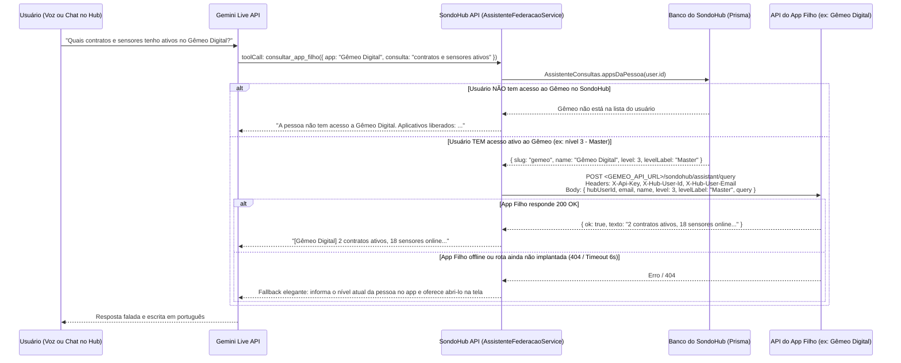

# Documentação Técnica — Assistente Federado (MCP HTTP), Contexto Reativo e Human-in-the-Loop no SondoHub

> **Escopo deste documento:** Documentar em detalhe tudo o que foi implementado na evolução v2 do Assistente de IA no `SondoHub`, com foco especial na arquitetura do **Assistente Federado (MCP HTTP)** entre o `SondoHub` e os aplicativos filhos (`Gêmeo Digital`, `Experience`, `SondoView`), além do **Contexto Reativo de Tela** e do **Controle de Escrita com Confirmação Visual (Human-in-the-Loop)**.

---

## 1. Visão Geral do Que Foi Construído

A evolução do assistente no `SondoHub` foi estruturada em subpastas independentes, testadas unitariamente e desacopladas para facilitar a manutenção e escalabilidade:

```text
sondohub/
├── packages/contracts/src/
│   └── assistente.ts                           # Contratos compartilhados (Propostas, Operações e Resultados)
├── apps/api/src/modules/assistente/
│   ├── federacao/                              # 1. Assistente Federado (MCP HTTP SondoHub ↔ Apps Filhos)
│   │   ├── federacao.types.ts                  # Tipos do protocolo HTTP federado (PayloadFederado, PedidoConsultaAppFilho)
│   │   ├── federacao.service.ts                # Validação de acesso no Hub, resolução de endpoints e chamada X-Api-Key
│   │   └── federacao.spec.ts                   # Testes unitários (bloqueio sem acesso, headers MCP HTTP e fallback)
│   ├── propostas/                              # 2. Escrita Administrativa com Confirmação (Human-in-the-Loop)
│   │   ├── proposta.types.ts                   # Tipos de propostas, TTL (2 min) e porta ADMIN_USERS_WRITER
│   │   ├── propostas.service.ts                # Criação de proposta sem gravar no banco + execução após POST /confirmar
│   │   └── propostas.spec.ts                   # Testes unitários (proposta, leitura do usuário da tela, expiração)
│   ├── contexto.ts                             # 3. Sanitização do estado reativo da tela (`estado`) para `ver_tela`
│   ├── contexto.spec.ts                        # Testes de sanitização e remoção de chaves sensíveis
│   ├── ferramentas.ts                          # Declaração de `consultar_app_filho` e `propor_alteracao_usuario`
│   ├── guia.ts                                 # Instruções no System Prompt para o Gemini usar as novas ferramentas
│   ├── executor.ts                             # Roteamento, checagem de papel Master e auditoria
│   ├── assistente.controller.ts                # Rotas POST /api/assistente/propostas/:id/confirmar e /cancelar
│   └── assistente.module.ts                    # Registro dos providers no NestJS
└── apps/hub/src/features/assistente/
    ├── contexto-tela/                          # Store reativo de estado da tela (estilo useCopilotReadable)
    │   ├── contexto-tela-store.ts              # publicarEstadoTela, usePublicarContextoTela, useEstadoTelaAssistente
    │   └── contexto-tela.spec.ts               # Testes unitários do store reativo
    ├── cards/                                  # Generative UI — Cards interativos no Chat e no Painel de Voz
    │   ├── card.types.ts                       # Tipos e ciclo de vida do card (pendente, confirmando, confirmada, erro)
    │   ├── CardConfirmacao.tsx                 # Card visual com botões Confirmar e Cancelar
    │   └── use-propostas-cards.ts              # Hook de confirmação HTTP + invalidação ao vivo do React Query
    ├── executar-acoes.ts                       # Validação da ação `confirmar_escrita` vinda pelo WebSocket
    └── components/
        ├── AssistenteBolinha.tsx               # Envia `estadoTela` no WS e renderiza cards no modo voz
        └── ChatAssistente.tsx                  # Renderiza cards dentro do fluxo do chat de texto
```

---

## 2. Assistente Federado (MCP HTTP): Como Foi Implementado no `SondoHub`

### 2.1. O Problema que Ele Resolve
O `SondoHub` é o portal central de identidade (SSO) e launcher da Sondotécnica, mas os dados operacionais de negócio moram nos bancos de cada aplicativo filho:
- **Gêmeo Digital (`gemeo`)**: Contratos, sensores IoT, monitoramento online/offline e modelos BIM (Autodesk Tandem).
- **SondoView (`sondoview`)**: Agências, modais, empreendimentos, avanço físico, EAP, Curva S, RDO/RDF, câmeras e mapa 3D/4D.
- **Experience (`experience`)**: Eventos, apresentações e pesquisas de satisfação.

O módulo **`federacao/`** transforma o Assistente do `SondoHub` em um **Host Federado (estilo MCP — Model Context Protocol sobre HTTP)**: o usuário conversa com um único assistente no Hub e pergunta sobre qualquer sistema a que tenha acesso.

### 2.2. Fluxo Completo de Segurança e Execução



### 2.3. Especificação do Protocolo MCP HTTP (`POST /sondohub/assistant/query`)

#### A) Resolução Automática de Endpoint e Credencial (`resolverEndpointAppFilho`)
Em `apps/api/src/modules/assistente/federacao/federacao.service.ts`, o Hub resolve para onde enviar a consulta de cada app filho a partir do `slug` cadastrado na tabela `applications`:

| App (`slug`) | Variável de URL no `.env` do Hub | Variável de Chave (`X-Api-Key`) no `.env` do Hub | Padrão / Observação |
| :--- | :--- | :--- | :--- |
| **`gemeo`** | `GEMEO_API_URL` *(opcional)* | `GDS_APY_KEY` *(já existe no Hub!)* | Padrão de URL já configurado: `https://gds-techlab.sondotecnica.com` |
| **`experience`** | `EXPERIENCE_API_URL` *(já existe no Hub!)* | `EXPERIENCE_API_KEY` *(já existe no Hub!)* | Reaproveita 100% as variáveis já existentes |
| **`sondoview`** | `SONDOVIEW_API_URL` | `SONDOVIEW_API_KEY` | Convenção genérica `<SLUG>_API_URL` e `<SLUG>_API_KEY` |
| **Qualquer novo app (`<slug>`)** | `<SLUG_MAIUSCULO>_API_URL` | `<SLUG_MAIUSCULO>_API_KEY` | Escalável sem precisar alterar código no `SondoHub`! |

#### B) Requisição Enviada pelo `SondoHub` ao App Filho
- **Método e Caminho**: `POST <API_URL>/sondohub/assistant/query`
  - *Nota importante para o Gêmeo Digital*: Como a URL base padrão é `https://gds-techlab.sondotecnica.com`, a chamada vai para `https://gds-techlab.sondotecnica.com/sondohub/assistant/query`. O prefixo `/sondohub/*` já é o mesmo utilizado por `PUT /sondohub/users/:id` (que passa pelo Nginx da VM direto para a API Express do Gêmeo sem colidir com o ChirpStack).
- **Timeout**: `6.000 ms` (`TIMEOUT_FEDERACAO_MS = 6_000`), garantindo que um app filho lento nunca trave a sessão de voz do usuário.
- **Headers HTTP**:
  ```http
  Content-Type: application/json
  X-Api-Key: <chave compartilhada entre Hub e App Filho>
  X-Hub-User-Id: <UUID do usuário no SondoHub>
  X-Hub-User-Email: <e-mail do usuário no SondoHub>
  ```
- **Corpo JSON (`PayloadFederado`)**:
  ```json
  {
    "hubUserId": "11111111-1111-4111-8111-111111111111",
    "email": "henrique@sondotecnica.com.br",
    "name": "Henrique Santos",
    "level": 3,
    "levelLabel": "Master",
    "query": "Quais contratos e sensores estão ativos?"
  }
  ```

#### C) Resposta Esperada do App Filho (`RespostaHttpAppFilho`)
O app filho deve responder `HTTP 200` com JSON contendo o campo `texto` (ou `text`) já resumido e pronto para leitura em voz alta:
```json
{
  "ok": true,
  "texto": "No Gêmeo Digital você tem acesso Master a 2 contratos (Hotel Fairmont e Sede). Há 24 sensores cadastrados, sendo 22 online e 2 sem comunicação nas últimas 24 horas."
}
```

#### D) Auditoria e Governança
- Toda chamada a `consultar_app_filho` passa pelo `AssistenteExecutor`:
  - Pode ser bloqueada por **Regras da Empresa** ou **Regras Pessoais** (basta adicionar `consultar_app_filho` na lista `bloqueia` de uma regra).
  - Tem seu resultado carimbado por `carimbarRegras(resultado, regrasSessao)`.
  - É registrada automaticamente na tabela **`assistente_audit`** com os argumentos (`app`, `consulta`) e o resumo da resposta devolvida pelo app filho.

---

## 3. Demais Entregas da v2 que Operam Junto com a Federação

### 3.1. Leitura Reativa do Estado da Tela (`contexto-tela/`)
- **No Frontend**: O hook `usePublicarContextoTela(estado)` (em `apps/hub/src/features/assistente/contexto-tela/contexto-tela-store.ts`) foi conectado às páginas:
  - `user-detail-page.tsx`: publica `{ pagina: 'detalhe_usuario', usuarioVisto: { id, nome, email, cargo, ativo }, appsLiberados }`.
  - `users-list-page.tsx`: publica `{ pagina: 'lista_usuarios', filtroAtivo, buscaDigitada, paginaAtual, usuariosVisiveis }`.
  - `dashboard-page.tsx`: publica `{ pagina: 'painel_master', periodoSelecionado, usuariosAtivos, usuariosTotal, sessoesAbertas }`.
- **No Backend**: `lerContextoTela` (`apps/api/src/modules/assistente/contexto.ts`) sanitiza o campo `estado`, removendo qualquer propriedade cujo nome combine com `/token|senha|password|auth|secret|credencial|chave|cookie|hash|key/i` e limitando o pacote a `4 KB`.

### 3.2. Controle de Escrita com Card de Confirmação (`propostas/` e `cards/`)
- **Ferramenta**: `propor_alteracao_usuario` (restrita a usuários `MASTER` no catálogo e validada novamente no servidor em `executor.ts`).
- **Operações suportadas**:
  - `liberar_app`: libera ou altera o nível de acesso de um usuário a um aplicativo (ao confirmar, chama `AdminUsersService.setAppLevel`, que já sincroniza via `PUT /sondohub/users/:id` com o **Gêmeo Digital** e o **Experience**!).
  - `remover_app`: revoga acesso a um aplicativo (`AdminUsersService.removeApp`, sincronizando `DELETE` com Gêmeo e Experience).
  - `autorizar_assistente`: liga ou desliga a permissão de uso do assistente (`AssistenteRepository.gravarPermissao`).
  - `alterar_cargo`: altera o cargo no Hub entre `USER`, `ADMIN` e `MASTER` (`AdminUsersService.update`).
  - `alterar_status`: ativa ou desativa a conta do usuário (`AdminUsersService.update`).
- **Segurança Human-in-the-Loop**: A IA **nunca executa a escrita diretamente**. Ela gera uma proposta com validade de 2 minutos que renderiza o componente `<CardConfirmacao />` no navegador. A gravação só ocorre quando o Master clica fisicamente no botão **Confirmar**, disparando `POST /api/assistente/propostas/:id/confirmar` protegido por `SessionGuard` + `MasterGuard`.
